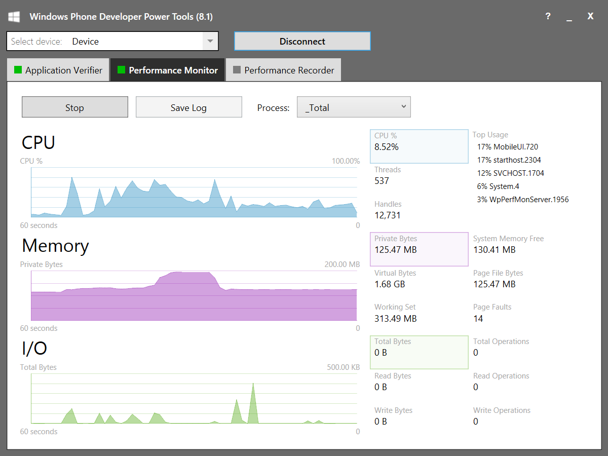

# Windows Phone Developer Power Tools (8.1)

The *Windows Phone Developer Power Tools* (`PwTools.exe`) run on the PC and analyse a phone connected by USB:

- **Performance Monitor**: live charts of CPU, memory and I/O, plus the top 5 processes. The values can be saved to a CSV file (`WpPerfMon_<date>.csv`).
- **Performance Recorder**: records an ETW trace (`.etl`) with WPR profiles (CPU, disk, file, heap, power, XAML, HTML…), to be opened in WPA.
- **Application Verifier**: enables the Application Verifier checks (heaps, handles, locks, leaks…) for an application installed on the phone.

They need some programs on the phone that aren't in the phone image. Normally `UpdatePack.exe` installs them through Windows Update; this page also explains how to install them by hand.



## Requirements

- A PC with the **Windows Phone SDK 8.1** (or Visual Studio 2013/2015 with the Windows Phone 8.1 tools). The Power Tools talk to the phone through *CoreCon*, the device connectivity layer of the SDK.
- A **developer-unlocked** phone running Windows Phone **8.1** (the tools refuse other versions), connected with a USB cable.
- The Power Tools files. They come in two folders:

| Folder | Content |
|---|---|
| `PowerTools\` | `PwTools.exe` (the PC application), `Components\` (Performance Monitor, Performance Recorder, Application Verifier), `Support\pdh.dll` (modified PDH used by the Performance Monitor), `Support\ARM\WpToolsSvc.exe` and `WpWpr.exe` (copied to the phone automatically) |
| `UpdatePack\` | `UpdatePack.exe` (installer of the phone packages) and `Support\ARM\DuTrigger.exe` |

- For the manual installation only: a command prompt on the phone that can run `reg import` and write to `C:\Windows\System32`, see [Telnet over USB](../telnetOverUsb/README.md).

## 1. Install the phone packages

The tools need 5 Microsoft packages (*Update Pack*) on the phone:

| Package | Files on the phone | Used by |
|---|---|---|
| `Microsoft.Tools.PerfMonExt` | `C:\Windows\System32\WpPerfMonServer.exe` | Performance Monitor |
| `Microsoft.Tools.DevToolSupport` | `C:\Windows\System32\BatteryLogger.exe`, `WpToolsWrapper.exe` | Performance Recorder (power), Application Verifier |
| `Microsoft.Tools.AppVerifExt` | `C:\Windows\System32\AppVerif.exe`, `verifier.dll`, `vrfcore.dll`, `vfbasics.dll` | Application Verifier |
| `Microsoft.Tools.HITMemTools` | `C:\Windows\System32\rld.exe`, `vfgcleak.dll`, `vfgcleakctl.dll` | Memory profiler |
| `Microsoft.Phone.Test.BaseOS.TraceLog` | `C:\Windows\System32\tracelog.exe` | Tracing |

Each package also writes a version in the registry of the phone:  
`HKEY_LOCAL_MACHINE\SOFTWARE\Microsoft\Windows Phone\Power Tools\Packages\<package or file>` → `Version` = `8.1.0.1`.  
This version is what the PC checks before it connects.

### Option A: with UpdatePack.exe (official way)

Run `UpdatePack.exe` on the PC with the phone connected and press *Install*.  
It copies a small helper to the phone (`DuTrigger.exe`), which enables the optional content `USERINSTALLABLE_MS_DEVTOOLSEXT` of the phone update service and starts an update scan. The phone then downloads and installs the packages from **Microsoft's update servers**, like an OS update. Wait until the installation is finished, then press *Rescan*.

The packages come from the update servers, not from the PC. If the servers don't offer them anymore, use option B.

### Option B: manual installation

1. Unzip PowerToolsPackages.zip on the PC.  
2. Copy the folder to the phone, for example to `C:\Data\Users\Public\PowerToolsPackages`.
3. In the command prompt of the phone:

```bat
cd C:\Data\Users\Public\PowerToolsPackages
install.cmd
```

4. Reboot the phone.

Besides the versions, the registry files only add two values: `VerifierProviders` = `vrfcore.dll vfbasics.dll` in `HKLM\SOFTWARE\Microsoft\Windows NT\CurrentVersion\Image File Execution Options\{ApplicationVerifierGlobalSettings}` (Application Verifier) and the ETW publisher `Microsoft-WindowsPhone-Rld` (memory profiler).

### Check the installation

On the phone:

```bat
reg query "HKLM\SOFTWARE\Microsoft\Windows Phone\Power Tools\Packages" /s /v Version
WpPerfMonServer.exe
```

`WpPerfMonServer.exe` must print `PerfMon: Listening for connections on address 127.0.0.1 and port 8889.` (stop it with Ctrl+C). This also proves that the phone accepts the signature of the binaries.

On the PC, with the phone connected:

```bat
UpdatePack.exe /checkOnly
echo %errorlevel%
```

`0` means that the packages are seen as installed; `-2147467259` (`E_FAIL`) means that they aren't.

## 2. Connect the Power Tools

1. Start `PwTools.exe` on the PC.
2. Select the device and press *Connect*.  
   The PC copies `WpToolsSvc.exe` and its transport `DeviceAgentTransport3.dll` to `C:\Data\SharedData\PhoneTools\PwTools\bin\` and starts them through the CoreCon client of the phone (`C:\Data\SharedData\PhoneTools\11.0\CoreCon\bin\ConManClient3.exe`). `WpToolsSvc.exe` is the agent that receives the commands of the PC.
3. The tabs of the three tools become available.

Only one instance of the Power Tools can be connected to a phone at a time.

To check the connection on the phone (`tlist -t`):

```
SVCHOST.EXE
  ConManClient3.exe
    WpToolsSvc.exe
```

## 3. Use the tools

### Performance Monitor

Press *Start*. The PC asks the agent to start `WpPerfMonServer.exe` on the phone, then reads the counters every second through the USB connection (`Processor Information`, `Memory`, `Process`…). Choose a process in the list to see its own counters. *Save log* writes the collected values to a CSV file.

On the phone, `WpPerfMonServer.exe` appears as a child of `svchost.exe -k WPTCBCritical`. It serves one session and stops when the PC disconnects.

### Performance Recorder

Select the profiles, press *Start*, run the scenario on the phone, then press *Stop* and save the `.etl` file. Open it with WPA, see [Performances](../Performances/README.md). The working files are in `C:\Data\SharedData\PhoneTools\PwTools\log` on the phone.

### Application Verifier

Choose an installed application, select the checks and apply. The settings are applied on the phone by `AppVerif.exe` (started through `WpToolsWrapper.exe`); its output is in `C:\Data\SharedData\PhoneTools\PwTools\log\appverif_output.txt`.

## Troubleshooting

| Message / symptom | Cause | Fix |
|---|---|---|
| *Update Pack has not been installed. The Update Pack must be installed on a physical device before Power Tools can connect to the device.* | `Version` values missing on the phone (`UpdatePack.exe /checkOnly` fails) | Install the packages ([step 1](#1-install-the-phone-packages)) |
| *Incompatible version of on-device service agent.* | Old `WpToolsSvc.exe` on the phone | Delete `C:\Data\SharedData\PhoneTools\PwTools\bin\WpToolsSvc.exe` and connect again |
| *Only one instance of Power Tools can connect to '…' at a time.* | Another `PwTools.exe` is connected | Close it |
| *Unsupported version* (UpdatePack.exe) | The phone isn't running Windows Phone 8.1 | — |
| The Performance Monitor stays empty | `WpPerfMonServer.exe` wasn't started on the phone | Start `C:\Windows\System32\WpPerfMonServer.exe` in the command prompt of the phone, then press *Start* again |
| Application Verifier or the battery logger fails after ~1 s (`E_ABORT`, 0x80004004) | `WpToolsWrapper.exe` didn't answer the start request | Check that `C:\Windows\System32\WpToolsWrapper.exe` exists and that the phone was rebooted after the installation |
